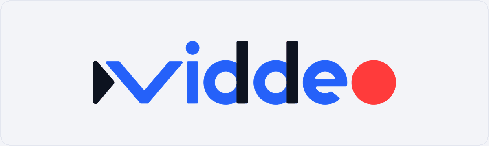

<p align="center">
  <picture>
    <source media="(prefers-reduced-motion: reduce)" srcset="brand/readme/banner.png">
    
  </picture>
</p>

<h3 align="center">Your screen. A little more cinematic.</h3>

<p align="center">
  Record your screen, bring the important moments into focus, and make something worth sharing.<br>
  Built for macOS with Swift and SwiftUI.
</p>

<p align="center">
  <a href="#what-it-does">Features</a> ·
  <a href="#get-started">Get started</a> ·
  <a href="#development">Development</a>
</p>

---

## What it does

Viddeo turns screen recordings into polished walkthroughs, product demos, and quick explainers. Capture a display, edit the take, and export with automatic zooms that follow your clicks.

- **Keep the action in focus.** Automatic zoom, a smooth rendered cursor, and click effects.
- **Shape the story.** Trim, split, reorder, change speed, and shorten silent stretches.
- **Make it yours.** Backgrounds, padding, rounded corners, captions, and keyboard shortcut overlays.
- **Bring your voice.** Microphone and system audio, separate volume controls, and optional camera overlay.
- **Share the result.** H.264 or HEVC video and GIF, with quality, resolution, and aspect ratio presets.

> **Early development.** Viddeo is a working app under active development. Some features still need testing with real recordings and devices.

## Get started

Requires **macOS 26+**, **Xcode with a macOS 26+ SDK**, selected with `xcode-select`, and **Node.js** on your `PATH` for the build script. The app has no third-party runtime dependencies.

```sh
./Scripts/build.sh
open .build/DerivedData/Build/Products/Debug/Viddeo.app
```

On first launch, allow **Screen Recording** and **Input Monitoring** in System Settings → Privacy & Security. Enable **Microphone** and **Camera** permissions if you use those inputs. Reopen the app if macOS requests it.

1. **Record.** Choose a display, select your audio inputs, and start recording.
2. **Refine.** Stop recording, edit the timeline, and adjust the zoom, background, captions, and audio.
3. **Export.** Choose a preset and save your video or GIF.

Raw recordings stay intact. Use **Save Project** to keep your edits and **Load Session** to pick up a recording later.

<details>
<summary><strong>Recording files & signing</strong></summary>

Sessions live in `~/Library/Application Support/Viddeo/Recordings/<UUID>/`. **Show Recording** opens the folder; **Load Session** opens its `session.json`. Project edits and settings are stored alongside the raw recording.

The build script uses the only available Apple Development identity when exactly one is installed, otherwise it signs ad hoc. To select an identity explicitly:

```sh
VIDDEO_SIGNING_IDENTITY="Apple Development: Your Name (TEAMID)" ./Scripts/build.sh
```

A stable signing identity helps macOS retain recording permissions across rebuilds.

</details>

## Development

Run the verification suite:

```sh
./Scripts/verify.sh
```

The suite checks capture and export behavior with synthetic media. Live recording, device permissions, and audio/video sync also need hands-on testing.

Explore the [architecture](docs/architecture.md), [specification](docs/spec.md), and [development plan](docs/plan.md).

## License

Copyright (C) 2026 Javier Santos.

Viddeo is licensed under the [GNU General Public License, version 3 only](LICENSE)
(`GPL-3.0-only`). Third-party material retains its own licenses.
